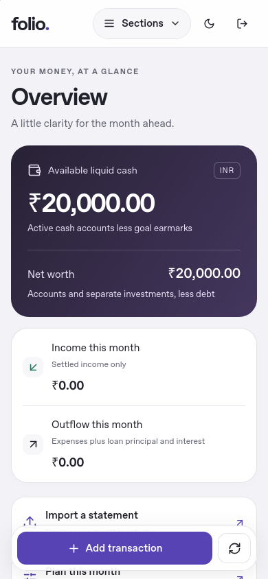
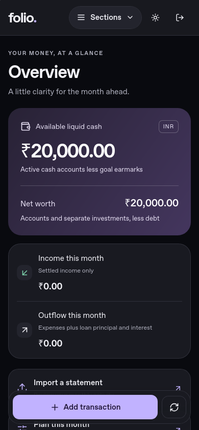

# Folio · iPhone design benchmark

## References and assessment

Apple's Human Interface Guidelines are the platform benchmark, with [Apple Wallet](https://www.apple.com/wallet/) as a reference for clear card hierarchy and [Copilot's Dashboard](https://help.copilot.money/en/articles/6045480-dashboard-tab-overview) as a finance-specific reference for an overview-first home and contextual drill-down. This is a design assessment, not a claim of an objective app ranking.

| Area | Previous Folio | Redesign |
| --- | --- | --- |
| Financial hierarchy | Four equally weighted metric tiles; currency could split across lines on narrow screens | One prominent cash card, secondary net worth, then clearly labelled actual monthly inflow/outflow; exact INR figures stay intact |
| Layout | Desktop-style padding and repeated status explanations | iPhone-first spacing, grouped cards, compact tracking disclosure and safe-area insets |
| Typography | Many 11–13px labels and captions, mixed inherited spacing | Apple system font on iPhone, relative text sizes, clear large titles, stronger secondary-text contrast and tabular financial figures |
| Navigation | Owner's closed vertical Sections menu | Preserve that preference and Overview-first opening, with sticky safe-area navigation and a scrollable vertical list |
| Frequent actions | Add transaction above content; refresh unavailable in the mobile header | A bottom action dock places Add transaction and Refresh within easier thumb reach; content reserves space beneath it |
| Forms | A desktop-sized centered modal | Full-width rounded sheet on narrow screens; visible close/save actions, focus trapping, background scroll lock and Visual Viewport keyboard adjustment |
| Charts | Multiple independent filter buttons and dense surrounding copy | Segmented chart choices, restrained color, themed axes/tooltips and clearer content grouping |
| Dark appearance | Shared styles could compete with private colors | Explicit private light/dark tokens, readable primary-button foreground and opaque fallbacks for materials |

The implementation follows Apple's [layout and safe-area guidance](https://developer.apple.com/design/human-interface-guidelines/layout), [typography guidance](https://developer.apple.com/design/human-interface-guidelines/typography), [accessibility guidance](https://developer.apple.com/design/human-interface-guidelines/accessibility), and [sheet guidance](https://developer.apple.com/design/human-interface-guidelines/sheets). Comfortable 44px-or-larger web hit areas adapt the platform touch-target principle. Financial content stays on solid surfaces; subtle translucent material is reserved for navigation/actions with an opaque fallback.

## What changes in the app

- Overview emphasizes available liquid cash, with its existing accounting definition. It is **not** relabelled as money available after emergency reserves. Net worth remains a separate measure.
- Actual monthly income/outflow remain distinct from the planned surplus. No fabricated growth, bank sync indicator or projected payment is presented as actual activity.
- Import a statement and Plan this month are direct shortcuts. Full detail and safeguards remain available in their existing sections.
- Tracking dates are a compact expandable explanation. No baseline, cutoff or ledger behavior changes.
- Financial records, PDF handling, simulator math, category rules, RLS and authentication/recovery remain unchanged. No database migration or financial-data write is part of the redesign.

## Implementation

`src/private/ios.css` provides the private design layer. Tokens apply only when the private app marks the document; the public synthetic demo retains its appearance. System fonts require no external font requests. Supporting private CSS uses relative font units. The viewport continues to permit browser zoom.

The native HTML dialog retains modal focus behavior and explicit confirmation. Mobile sheets use Visual Viewport events to size/reposition around available keyboard space and clean up listeners/scroll lock when closed. Native file inputs, date inputs and selects remain usable. No decorative drag handle promises an unsupported swipe interaction.

Private manifest/background/theme-color metadata match the redesigned app; demo metadata is preserved. Static-shell caching and exact-origin CSP are unchanged. Motion/transparency preferences have reduced-effect fallbacks. Large values preserve paise and full text; unusually large text can scroll inside a monetary figure instead of clipping or rounding the value.

## Validation and limits

Run lint, typecheck, production build and the full private browser suite. The additional design checks cover 320/375/390/430px viewports, both themes, 200% root text size, supported large integer-paise amounts, action sizes and sheet viewport/scroll cleanup. Only synthetic fixtures may appear in screenshots.

`npm run test:ios` runs selected auth, navigation, PDF and design flows using Playwright WebKit with a touch viewport. Install its engine/dependencies with `npx playwright install --with-deps webkit`. CI includes this check in addition to Chromium and all existing accounting/isolation suites. WebKit fixtures block service workers to keep fake API interception deterministic on reload; actual PWA installation/cache checks run in Chromium and hosted release preflight.

WebKit emulation is not a physical iPhone, native Dynamic Type or an Apple certification. The installed PWA still needs a final check on the owner's phone for status-bar/safe-area appearance, keyboard behavior, VoiceOver, browser text settings and file selection. Keep normal zoom enabled; do not claim a Linux browser run verifies every iOS version.

## Browser previews

These are synthetic fixtures at an iPhone-sized viewport, not screenshots of the owner's financial records or a physical iPhone.

| Light appearance | Dark appearance |
| --- | --- |
|  |  |

Observed local checks: lint/typecheck, 187 Vitest tests and two release-verification tests passed; all nine selected WebKit flows passed. The original 42 Chromium flows and the three new design cases passed in development; the final combined suite and CI are required before release. Core text/background, secondary-text/surface and primary-button token pairs meet a 4.5:1 contrast threshold in both themes. Physical-device acceptance remains separate.
